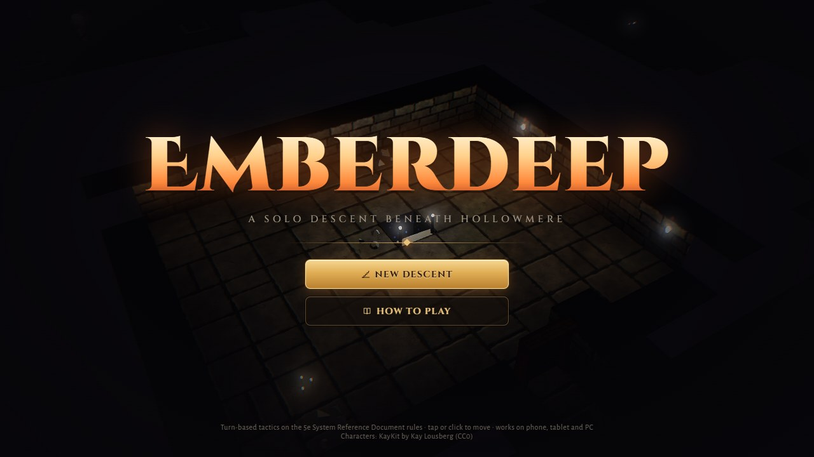
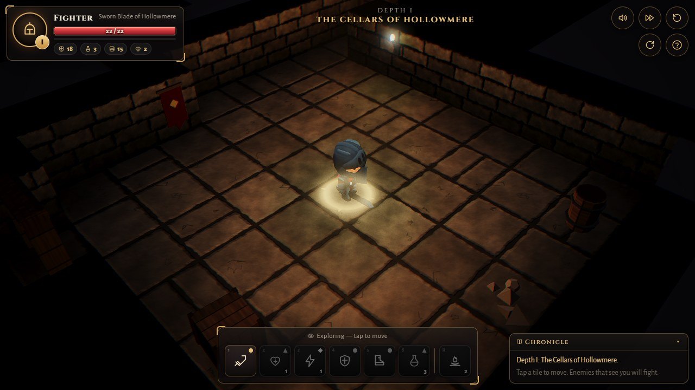
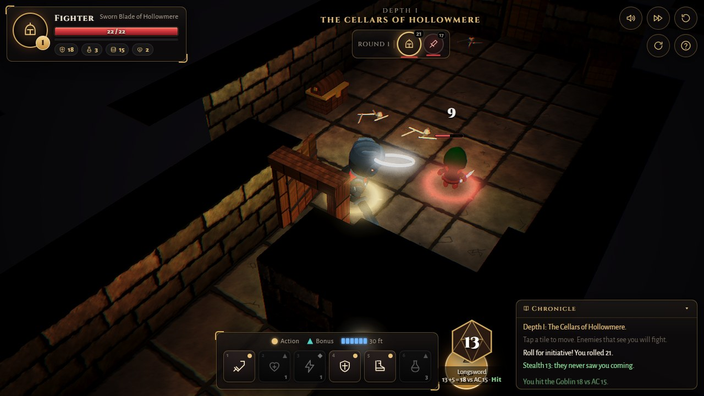
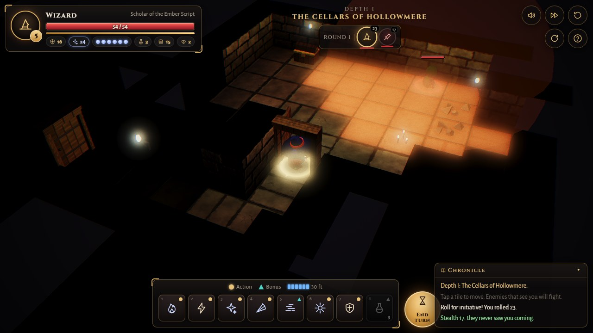
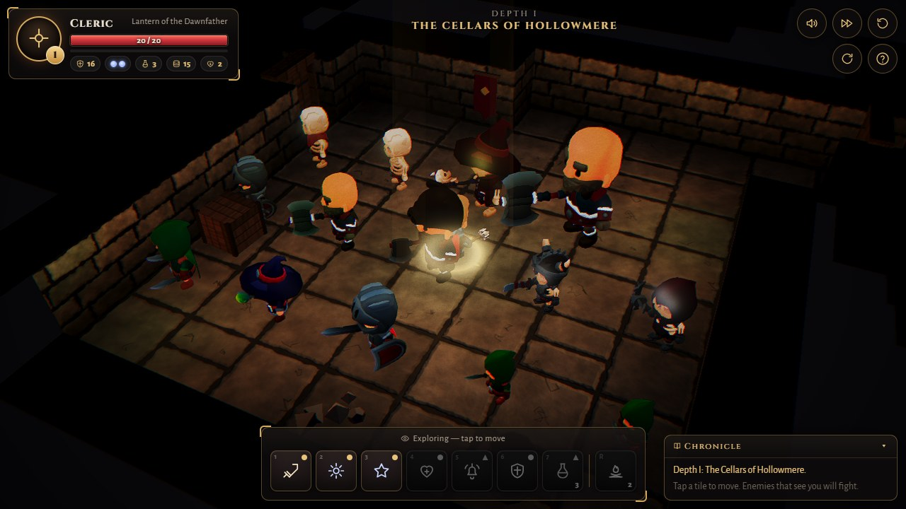
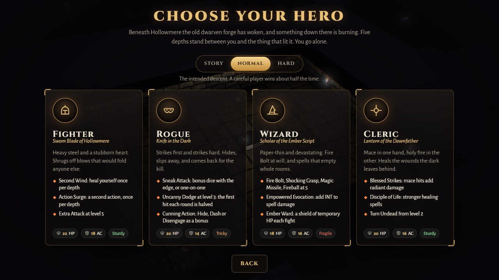
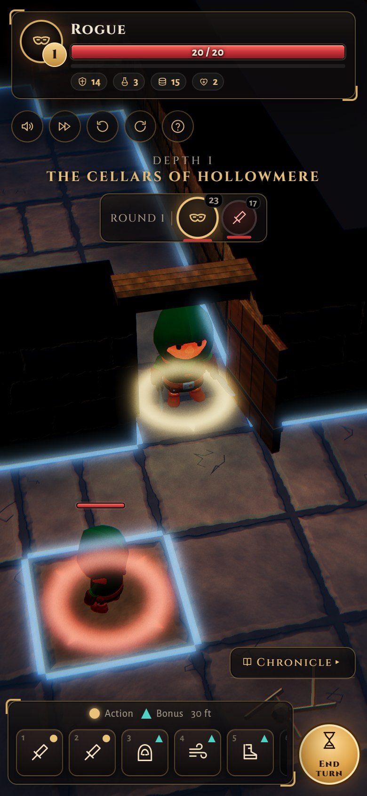

# Emberdeep

**A solo, turn-based 3D dungeon crawl that plays instantly in the browser on phone, tablet and PC.**

Beneath the town of Hollowmere the old dwarven forge has woken, and something down there is burning. Pick a hero, descend five depths of torchlit stone, and face the thing that lit it. You go alone.

### ▶ [Play it now: zariffromlatif.github.io/emberdeep](https://zariffromlatif.github.io/emberdeep/)

No install, no account. Your run saves in the browser between depths.



## Screenshots

| | |
|---|---|
|  |  |
| **Explore** by tap or click. Fog of war lifts as you go, and walls between you and the camera drop away. | **Fight** in turns. Every attack is a real d20 roll against Armour Class, shown in the dice tray and the Chronicle. |
|  |  |
| **Cast** Fire Bolt, Burning Hands, Misty Step and Fireball. Area spells can catch you too. | **Meet the bestiary**: goblins, hobgoblins, orcs, bugbears, an ogre, the restless dead and Varrow, the Ember Wight. |

<p align="center">
  
  &nbsp;
  
</p>

## Features

- **Four heroes** built on the 5e rules: the **Fighter** (Second Wind, Action Surge, Extra Attack), **Rogue** (Sneak Attack, Cunning Action, Uncanny Dodge), **Wizard** (Fire Bolt, Shocking Grasp, Magic Missile, Burning Hands, Misty Step, Fireball, Ember Ward) and **Cleric** (Sacred Flame, Guiding Bolt, healing spells, Turn Undead).
- **Real tabletop combat**: initiative and surprise, movement plus an action and a bonus action per turn, advantage and disadvantage, saving throws, critical hits, and opportunity attacks. Hover a foe to see your exact chance to hit.
- **Five generated depths**, each with its own palette and monsters, ending at the Ember Throne. The same seed always builds the same dungeon.
- **Between fights**: short rests (with a risk of wandering monsters), chests and loot, levelling to 5, and a campfire shop between depths.
- **Three difficulties**: Story, Normal and Hard, each tuned against a bot that plays like a careful human (see [Difficulty](#difficulty)).
- **Made to look and sound good everywhere**: torchlight and bloom, procedurally generated stone and brick, animated KayKit characters, spell effects, and sound synthesised on the fly. Phone-first layout with touch, mouse and keyboard controls.

## How to play

| | |
|---|---|
| **Move** | Tap or click a tile. In combat, the blue area is how far you can go this turn. |
| **Attack** | Tap an enemy to attack with your default weapon or spell, or pick an ability first. |
| **Abilities** | The bar along the bottom. A gold circle costs your action, a teal triangle your bonus action. |
| **End turn** | The round gold button, or <kbd>Space</kbd>. |
| **Camera** | Drag to orbit, pinch or scroll to zoom, <kbd>Q</kbd>/<kbd>E</kbd> to rotate. |
| **Keyboard** | <kbd>1</kbd>–<kbd>9</kbd> abilities · <kbd>W</kbd><kbd>A</kbd><kbd>S</kbd><kbd>D</kbd> step · <kbd>R</kbd> rest · <kbd>L</kbd> log · <kbd>Esc</kbd> cancel |

Walking away from an adjacent enemy gives it a free swing. Rest when you can, and spend your gold on potions at the campfire.

## Difficulty

Each setting is a small table of dials in [`src/rules/difficulty.ts`](src/rules/difficulty.ts). Win rates come from 100 seeded runs per class with the competent-player bot in [`tests/bot.ts`](tests/bot.ts). It plays the way a careful person does: focus fire, timely healing, resting, and class tactics.

| | Story | **Normal** | Hard |
|---|---|---|---|
| Bot wins (all classes) | ~90% | **~51%** | ~15% |
| Extra hero HP | +10, +2 per level | — | — |
| Starting potions | 5 | 3 | 3 |
| Short rests per depth | 3 | 2 | 1 |
| Defy Death per depth | 2 | 1 | none |
| Monster HP | ×0.8 | ×1 | ×1.1 |
| Monster numbers | ×0.85 | ×1 | ×1.1 |

On Normal the Fighter is the most forgiving class (~65%) and the Wizard the most demanding (~39%), matching the *Sturdy* and *Fragile* labels on the hero cards.

## Run it locally

Needs [Node.js](https://nodejs.org/) 22 or newer.

```sh
npm install
npm run dev        # play at the printed localhost address
npm test           # rules, dungeon generation, and whole-run autoplay guards
npm run build      # type-check and build into dist/
```

**Balance report.** Plays 60 seeded runs per class and prints win and death rates by depth:

```sh
BALANCE=1 npx vitest run tests/balance.test.ts
BALANCE=1 BALANCE_DIFFICULTY=hard BALANCE_RUNS=100 npx vitest run tests/balance.test.ts
```

(In PowerShell, set variables first: `$env:BALANCE=1; npx vitest run tests/balance.test.ts`.)

**Screenshots.** The images above are regenerated by driving headless Chrome against the live site:

```sh
node tools/screenshots.mjs
```

## How it's built

- **[Babylon.js](https://www.babylonjs.com/) 9 + TypeScript + Vite.** Babylon is imported per module through [`src/render/babylon.ts`](src/render/babylon.ts), so only the parts in use ship (about 530 KB of JavaScript gzipped at startup).
- **The rules never touch the renderer.** [`src/game`](src/game), [`src/rules`](src/rules) and [`src/dungeon`](src/dungeon) are plain TypeScript with seeded randomness. A command returns a list of events, and [`src/app.ts`](src/app.ts) plays them back as animation, sound and UI. That's what lets the bot play thousands of runs in seconds.
- **Almost nothing is downloaded.** Stone, brick, wood, rugs and particles are generated in code, sound is synthesised with Web Audio, and props are built from primitives. The only asset files are the KayKit characters, trimmed to the animations the game uses ([`tools/trim_glb.py`](tools/trim_glb.py)) and loaded per depth.
- **Deploys itself.** Every push to `main` runs the tests, builds, and publishes to GitHub Pages ([`.github/workflows/pages.yml`](.github/workflows/pages.yml)).

```
src/
  core/      dice, seeded RNG, grid maths
  rules/     classes, monsters, difficulty
  dungeon/   generation, field of view, pathfinding
  game/      turns, combat, hero actions, monster AI
  render/    stage, level, characters, effects, overlays, KayKit loader
  ui/        HUD, screens, icons
  audio/     synthesised sound and ambience
tests/       unit tests, the competent-player bot, balance report
tools/       model trimming, screenshot capture
```

## Credits

- **Characters:** [KayKit Character Pack: Adventurers](https://kaylousberg.itch.io/kaykit-adventurers) and [KayKit Character Pack: Skeletons](https://kaylousberg.itch.io/kaykit-skeletons) by Kay Lousberg ([kaylousberg.com](https://www.kaylousberg.com/)), released under [CC0](https://creativecommons.org/publicdomain/zero/1.0/). Licence files are in [`public/models/kaykit`](public/models/kaykit).
- **Fonts:** [Cinzel](https://fonts.google.com/specimen/Cinzel), [Cinzel Decorative](https://fonts.google.com/specimen/Cinzel+Decorative) and [Alegreya Sans](https://fonts.google.com/specimen/Alegreya+Sans), under the SIL Open Font License, served by Google Fonts.
- **Engine:** [Babylon.js](https://github.com/BabylonJS/Babylon.js), Apache License 2.0.
- **Rules:** This work includes material taken from the System Reference Document 5.1 ("SRD 5.1") by Wizards of the Coast LLC and available at <https://dnd.wizards.com/resources/systems-reference-document>. The SRD 5.1 is licensed under the Creative Commons Attribution 4.0 International License available at <https://creativecommons.org/licenses/by/4.0/legalcode>.

Some rules are adapted for solo play (for example Ember Ward, Defy Death, Blessed Strikes and the bonus hero hit points). The world of Hollowmere, its story and characters are original. Emberdeep is not affiliated with or endorsed by Wizards of the Coast.
